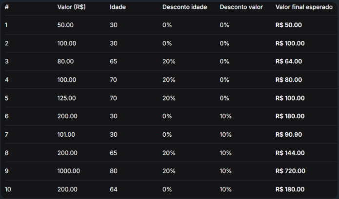

# Sistema de Ponto de Venda (PDV) com Descontos

## 📌 O que o código faz
Este programa simula um sistema de Ponto de Venda (PDV) para registrar compras de clientes e calcular descontos progressivos com base na idade do comprador e no valor final do pedido. Ao encerrar o atendimento, o sistema gera um relatório com o total de compras, total bruto, percentual total de descontos aplicados e o valor total final arrecadado.

---

## ⚙️ Como ele faz
1. **Entrada de dados:** O programa solicita continuamente a **idade** do cliente e o **valor da compra**.
2. **Desconto de Idade (Senioridade):** Se a idade do cliente for maior ou igual a **65 anos**, é aplicado um desconto de **20%** sobre o valor total da compra.
3. **Desconto por Valor:** Em seguida, o sistema verifica se o valor atualizado (já com o desconto de idade, se houver) é maior que **R$ 100,00**. Se for, aplica um desconto adicional de **10%**.
4. **Armazenamento:** Cada transação bem-sucedida armazena o valor bruto, a porcentagem total de desconto aplicada e o valor líquido final em uma lista.
5. **Validação e Encerramento:** 
   - Se o valor ou idade inserido for negativo, o sistema exibe uma mensagem de alerta.
   - Se o valor digitado for `0`, o loop de vendas é encerrado.
6. **Resumo Final:** Ao final da execução, o programa percorre a lista de compras realizadas, calcula os totais acumulados e exibe um resumo estatístico na tela.

---

## 🧪 Tabela de Exemplos / Casos de Teste



---

## 🚀 Como rodar o programa

Certifique-se de ter o Python instalado em sua máquina. Abra o terminal na pasta onde está localizado o arquivo `pdv.py` e execute o comando:

```bash
python pdv.py
```